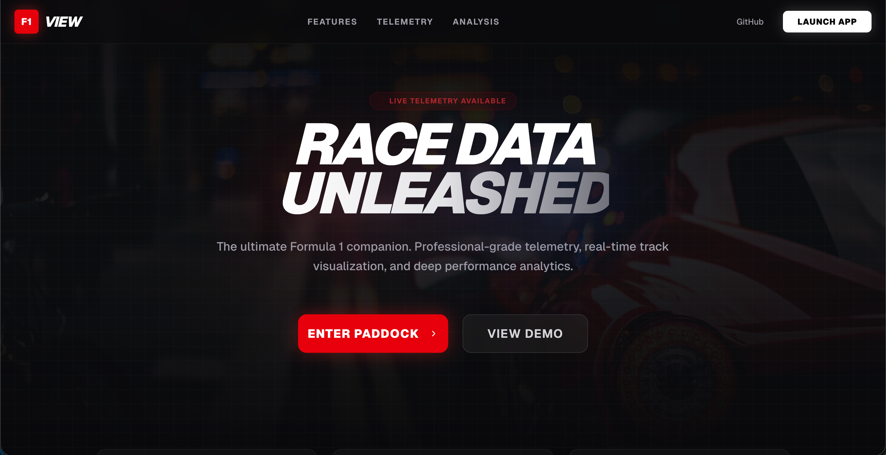

# F1 View - Formula 1 Telemetry & Race Analytics

<div align="center">



### F1 View is a professional-grade telemetry and analytics platform designed for Formula 1 enthusiasts and data analysts. It provides real-time track visualization, driver performance comparisons, and deep dives into race strategy, offering an immersive "paddock" experience directly in the browser.

[](https://f1-view.vercel.app/)
[](https://nextjs.org/)
[](https://fastapi.tiangolo.com/)
[](https://tailwindcss.com/)
[](LICENSE)

[🚀 Live Demo](https://f1-view.vercel.app/) · [🐞 Report Bug](https://github.com/dipayon-dip/f1-view/issues) · [✨ Request Feature](https://github.com/dipayon-dip/f1-view/issues)

</div>

---

## 🏎️ About The Project

F1 View bridges the gap between broadcast visuals and raw engineering data. Built for speed and precision, the application processes complex telemetry data to render interactive track maps, sector analyses, and live championship standings.

Whether you are analyzing tire degradation curves, comparing throttle traces between drivers, or just tracking the live standings, F1 View provides the insights that power champions.

### Key Features

*   **📊 Live Telemetry**: Real-time visualization of speed, throttle, brake, and RPM data with ultra-low latency.
*   **🗺️ Interactive Track Dominance**: Dynamic track maps featuring sector-by-sector analysis and driver comparison overlays.
*   **🏆 Championship Tracker**: Live standings, constructor battles, and historical points analysis.
*   **⚡ Performance Analytics**: Deep dive tools for analyzing tire degradation, fuel load effects, and aerodynamic efficiency.
*   **📰 Technical Insights**: Integrated news feed covering technical developments and strategic breakdowns (e.g., Undercuts vs. Overcuts).
*   **⏯️ Session Replays**: Relive specific race moments with advanced replay tools.

---

## 🛠️ Tech Stack

*   **Framework**: Next.js (React)
*   **Styling**: Tailwind CSS
*   **Deployment**: Vercel
*   **Data**: Integration with F1 Telemetry APIs (OpenF1/FastF1)
*   **Visualization**: Interactive charts and mapping libraries

---

## 🚀 Getting Started

Follow these steps to set up the project locally.

### Prerequisites

*   **Node.js** (v18 or higher)
*   **Python** (v3.9 or higher)
*   **npm** or **yarn**

### Installation

1.  **Clone the repository**
    ```bash
    git clone https://github.com/dipayon-dip/f1-view.git
    cd f1-view
    ```

2.  **Install Frontend Dependencies**
    ```bash
    npm install
    ```

3.  **Setup Backend**
    ```bash
    cd backend
    python -m venv .venv
    source .venv/bin/activate  # Windows: .venv\Scripts\activate
    pip install -r requirements.txt
    ```

4.  **Start Development Servers**

    *   **Backend** (Terminal 1):
        ```bash
        fastapi dev main.py --host 0.0.0.0 --port 8001
        ```

    *   **Frontend** (Terminal 2):
        ```bash
        npm run dev
        ```

5.  **Access the App**
    Open [http://localhost:3000](http://localhost:3000) in your browser.

---

## 📦 Deployment

### Docker (Recommended)

For a production-ready deployment using Docker:

```bash
docker-compose up -d --build
```

The application will be available at `http://localhost:3000`.

---

## 👥 Authors

*   **Dip Kundu** - *Developer* - [GitHub](https://github.com/HeatsinkDip)
*   **Md Jahidul Hossain Mekat** - *Developer* - [GitHub](https://github.com/Phanthom-Mekat)

---

## � License

Distributed under the MIT License. See `LICENSE` for more information.

## 🙏 Acknowledgments

*   [FastF1](https://github.com/theOehrly/Fast-F1) for the incredible open-source telemetry library.
*   [Formula 1](https://www.formula1.com/) for the sport we love.
*   [Vercel](https://vercel.com/) for hosting the frontend.

---

## 📄 Disclaimer

F1 View is an unofficial project and is not associated in any way with the Formula 1 companies. F1, FORMULA ONE, FORMULA 1, FIA FORMULA ONE WORLD CHAMPIONSHIP, GRAND PRIX and related marks are trade marks of Formula One Licensing B.V.

---


<div align="center">
  <p>Built with Love for the F1 Community</p>
</div>
